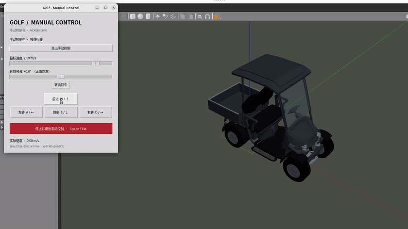

# golf_cart_sim

[English](README.md) | **简体中文**

基于 ROS 2 Humble 和 Gazebo Classic 11 的阿克曼转向高尔夫小车仿真，包含车辆模型、控制接口和独立手动控制 UI。

[](docs/media/golf-demo.mp4)

## 安装与启动

环境：Ubuntu 22.04、ROS 2 Humble、Gazebo Classic 11。

使用 Git LFS 克隆项目，并在 ROS 工作空间中编译：

```bash
sudo apt install git-lfs
git lfs install
mkdir -p ~/ros2_ws/src
cd ~/ros2_ws/src
git clone https://github.com/max-niuniu/golf_cart_sim.git
cd golf_cart_sim
git lfs pull
cd ../..
source /opt/ros/humble/setup.bash
rosdep install --from-paths src --ignore-src -r -y
colcon build --packages-select golf_cart_sim --cmake-args -DCMAKE_BUILD_TYPE=Release
source install/setup.bash
ros2 launch golf_cart_sim sim.launch.py
```

默认打开 Gazebo 和手动控制窗口。

模型网格使用 Git LFS 存储，请使用上述克隆命令下载完整模型。

## 手动控制

点击“启用手动控制”后操作：

- **W / S 或 ↑ / ↓**：按住前进或倒车，松开减速停车。
- **A / D 或 ← / →**：按住左转或右转。
- **鼠标**：滑块调节速度和转向，按住前进或倒车按钮行驶。
- **Space / Esc / 停止按钮**：停车并退出手动控制；窗口失焦或关闭也会退出。

UI 与车辆控制为独立节点。使用外部控制器时，请先退出手动控制。

## ROS 接口

| 话题 | 消息类型 | 用途 |
|---|---|---|
| `/golf/drive` | `ackermann_msgs/msg/AckermannDriveStamped` | 车辆控制输入 |
| `/golf/odom` | `nav_msgs/msg/Odometry` | 仿真真值里程计 |
| `/golf/joint_states` | `sensor_msgs/msg/JointState` | 车轮与转向关节状态 |
| `/tf`、`/tf_static` | `tf2_msgs/msg/TFMessage` | 坐标变换 |

控制输入使用 `drive.speed`（m/s，正数前进）和 `drive.steering_angle`（rad，正数左转的等效前轮转角），其余字段不参与控制。建议以 20 Hz 发送；超过 0.5 秒未收到指令，车辆减速停车。

## 配置

车辆尺寸和控制参数位于 `config/vehicle.yaml`，修改后重新编译。

启动参数可追加在 `ros2 launch golf_cart_sim sim.launch.py` 后：

| 参数 | 说明 |
|---|---|
| `manual_ui:=false` | 关闭手动控制 UI |
| `gui:=false manual_ui:=false` | 无窗口运行 |
| `detailed_visuals:=false` | 使用简化外观 |
| `world:=/path/to/world.world` | 指定场景 |
| `config:=/path/to/vehicle.yaml` | 指定车辆配置 |
| `x:=0 y:=0 z:=0.30 yaw:=0` | 初始位置（m）和朝向（rad）；z 为后轴中心高度 |

## 贡献者

| 贡献者 | 贡献 | 联系方式 |
|---|---|---|
| [Tianwei Niu (@max-niuniu)](https://github.com/max-niuniu) | ROS 仿真包开发与维护 | [tianwei.niu@cau.edu.cn](mailto:tianwei.niu@cau.edu.cn) |
| Zhongbiao He | SolidWorks 车辆模型建模 | [b20263081029@cau.edu.cn](mailto:b20263081029@cau.edu.cn) |
